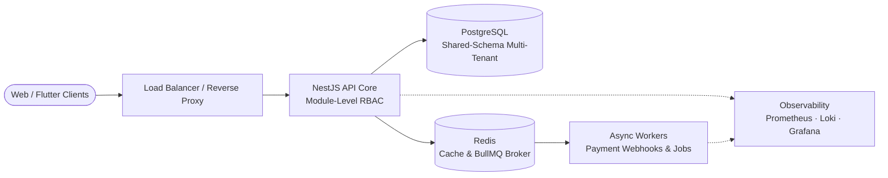

# Shivam Singh
**Software Engineer — Backend & Distributed Systems**[cite: 1]  
*Designing multi-tenant SaaS architectures, high-throughput APIs, and production cloud infrastructure.*[cite: 1]

> *Note: My day-to-day production commits live on separate company/organization GitHub accounts.*

---

### ⚡ Production Footprint

- **Multi-Tenant SaaS Architecture:** Engineered shared-schema data isolation and module-level RBAC to enforce strict tenant boundaries at scale[cite: 1].
- **High-Throughput Commerce & Payments:** Architected an end-to-end commerce backend on AWS EC2 with a custom credit system and webhook-driven payment pipelines, sustaining **1,000 req/sec** in load tests[cite: 1].
- **End-to-End Delivery:** Shipped cross-platform mobile (Flutter) and web (Next.js) applications backed by hardened NestJS/PostgreSQL services, async job queues, and full-stack observability[cite: 1].

---

### 🌐 Open Source

- **[OpenClaude (`PR #249`)](https://github.com/Gitlawb/openclaude/pull/249)** — Fixed a memory-exhausting infinite retry loop in the CLI authentication flow by implementing exponential backoff and a retry cap while preserving transient-failure retries[cite: 1].

---

### 🏗 Reference Architecture I Build & Operate

---

### 🛠 Systems & Tooling

| Layer | Technologies |
| :--- | :--- |
| **Core Backend** | TypeScript, Node.js, NestJS, Express, REST, WebSockets, BullMQ[cite: 1] |
| **Data & ORM** | PostgreSQL, Redis, MongoDB, Prisma[cite: 1] |
| **Infra & DevOps** | AWS (EC2), DigitalOcean, Kubernetes, Docker, GitHub Actions[cite: 1] |
| **Observability & QA** | Prometheus, Grafana, Loki, Jest, Vitest, Postman[cite: 1] |
| **Client & Mobile** | Next.js, React, React Query, Tailwind CSS, Flutter[cite: 1] |
| **AI & Automation** | Model Context Protocol (MCP), Agentic Workflows, Claude Code, OpenCode, Python[cite: 1] |

---

<b>🔍 Engineering Principles & Focus Areas (Click to expand)</b>

 

- **Idempotency by Default:** Payment webhooks, credit ledgers, and distributed queue consumers (`BullMQ`) are built to handle duplicate deliveries safely without state corruption[cite: 1].
- **Tenant Isolation First:** Permission boundaries and data scoping are enforced systematically at the guard and schema layers[cite: 1].
- **Measure Before Optimizing:** From cutting frontend Lighthouse load times by 30% to sustaining 1k RPS on backend services, bottlenecks are validated via load testing and telemetry (`Prometheus`/`Grafana`)[cite: 1].

